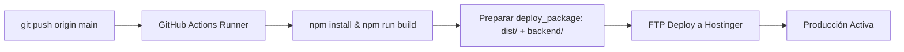

# AGENTS.md — Guía Técnica para Agentes de Código (Codex / Asistentes IA)

Este documento contiene las directrices de arquitectura, compilación, despliegue y uso de Git necesarias para que cualquier agente de código (Codex, Antigravity, etc.) realice cambios, correcciones y extensiones en **HarpHub** de forma segura y eficiente.

---

## 1. Visión General del Sistema

**HarpHub** es una plataforma web para el aprendizaje interactivo de armónica diatónica y otros instrumentos (guitarra, ukelele, piano), con soporte para tablaturas interactivas (AlphaTab/Guitar Pro y SEA harmonica tabs), análisis de audio en tiempo real, reproductor universal de medios y rutas de aprendizaje guiadas.

### Stack Tecnológico
- **Frontend**: React 19, Vite 7, TailwindCSS v4 (`@tailwindcss/vite`), React Router DOM v7, Lucide Icons, Framer Motion, Tone.js, WebMidi, `@coderline/alphatab`, Chart.js.
- **Backend**: PHP vanilla con PDO (`backend/api_harphub.php`).
- **Base de Datos**: MySQL / MariaDB (`harphub` en local / `u803496046_harphub` en producción).
- **Entorno Local**: XAMPP (`http://localhost/harphub`).
- **Entorno de Producción**: Hostinger (despliegue continuo con GitHub Actions).

---

## 2. Compilación y Ejecución Local

### Comandos Principales
```bash
# 1. Instalar dependencias (ejecuta postinstall: node scripts/copy-alphatab.js)
npm install

# 2. Iniciar servidor de desarrollo en Vite (puerto 5173 por defecto)
npm run dev

# 3. Compilar para producción (OBLIGATORIO validar antes de hacer push)
npm run build

# 4. Previsualizar bundle de producción localmente
npm run preview
```

### Scripts Internos Clave
- `scripts/copy-alphatab.js`: Copia los bundles y workers de AlphaTab desde `node_modules/@coderline/alphatab/dist` hacia `public/assets/`. Se ejecuta automáticamente en `postinstall` y `prebuild`.
- `scripts/generate-icons.js`: Genera los iconos PWA en `public/`. Se ejecuta automáticamente en `prebuild`.

> [!IMPORTANT]
> **Nunca omitas `npm run build`**: Toda modificación en código React/Vite debe compilar sin errores antes de confirmar o enviar a la rama principal.

---

## 3. Protocolo de Git y Control de Versiones

### Rama de Producción
- La rama activa de producción es `main`.
- Cualquier commit empujado a `origin main` desencadena automáticamente el pipeline de despliegue a Hostinger.

### Flujo de Trabajo Recomendado para Agentes
1. **Revisar estado de cambios**:
   ```bash
   git status -s
   ```
2. **Validar compilación completa**:
   ```bash
   npm run build
   ```
3. **Confirmar archivos modificados con mensajes semánticos**:
   ```bash
   git add <archivos específicos>
   git commit -m "feat/fix/refactor: descripción clara y concisa del cambio"
   ```
4. **Publicar cambios**:
   ```bash
   git push origin main
   ```

---

## 4. Pipeline de Despliegue (Hostinger & GitHub Actions)

El despliegue está automatizado mediante GitHub Actions en [`.github/workflows/deploy.yml`](file:///.github/workflows/deploy.yml):



### Configuración de la Base de Datos Dual (`backend/db_config.php`)
El archivo detecta automáticamente el entorno mediante el header del host:
- **Local (XAMPP)**: Conecta a `localhost`, BD `harphub`, usuario `root`, sin contraseña.
- **Producción (Hostinger)**: Conecta a la base de datos de producción `u803496046_harphub`.

### Manejo de Migraciones de Base de Datos
- Las nuevas columnas o tablas deben agregarse de manera idempotente (no destructiva) en `backend/api_harphub.php` usando bloques try-catch al inicializar la base de datos:
  ```php
  try {
      $pdo->exec("ALTER TABLE nombre_tabla ADD COLUMN nombre_columna INT DEFAULT 0");
  } catch (Exception $e) {}
  ```
- Si se requieren esquemas extensos, guardar el script SQL en la carpeta `migrations/`.

---

## 5. Arquitectura del Código y Reglas de Negocio

### 5.1 Comunicación Frontend <-> Backend
- Todo el tráfico de API pasa por [`src/services/api.js`](file:///src/services/api.js).
- En desarrollo apunta a `http://localhost/harphub/backend/api_harphub.php`.
- En producción apunta a `/backend/api_harphub.php`.
- Cada petición envía el parámetro `action` que `api_harphub.php` procesa mediante un `switch`/`if` principal con sentencias preparadas PDO.

### 5.2 Estructura Modular de Lecciones (`WebLessonLayout.jsx`)
Las lecciones se componen de bloques modulares:
1. `video`: Video universal (YouTube normal, Shorts, TikTok, Instagram, MP4).
2. `tab` / `gp-tab`: Partituras Guitar Pro con reproductor AlphaTab.
3. `sea-tab`: Tablatura armónica interactiva SEA.
4. `notes`: Notas personales del estudiante.
5. `attachments` / `links`: Materiales descargables y enlaces complementarios.
6. `practice`: Herramientas de estudio, loops y metrónomo.

> [!WARNING]
> **Regla de Visibilidad de Bloques**:
> - Los bloques de contenido estático vacíos (ej. AlphaTab sin archivo `.gp`, video sin enlace, texto sin contenido) **NO deben mostrarse**, aun si existen en la plantilla.
> - Los bloques interactivos para el estudiante (tablatura SEA editable, notas personales, herramientas de práctica) **SIEMPRE deben mostrarse**, ya que su propósito es que el estudiante los complete e interactúe con ellos.

### 5.3 Semáforo de Dominio y Grado de Avance
El estudiante marca su propio grado de avance subjetivo mediante una barra de energía de 4 niveles:
- **25% (Iniciada)**: Primer contacto, notas base y estructura.
- **50% (En Práctica)**: Memorización, loops y tempo moderado.
- **75% (Avanzada)**: Fluidez a tempo real, sonido y afinación.
- **100% (Dominada)**: Lección conquistada e incorporada al repertorio.

Se persiste en la tabla `user_progress` (`progress_level`, `status`) y se sincroniza en la UI mediante el evento global:
```javascript
window.dispatchEvent(new CustomEvent('lesson-updated', { 
    detail: { lessonId, progressLevel, completed } 
}));
```

### 5.4 Reproducción Universal de Medios (`mediaEmbed.js`)
- Ubicado en [`src/utils/mediaEmbed.js`](file:///src/utils/mediaEmbed.js).
- Analiza y normaliza URLs de YouTube (incluyendo formatos `/shorts/`), TikTok, Instagram y enlaces directos de video/audio para el reproductor unificado con marcadores A-B y bookmarks por usuario.

---

## 6. Checklist de Validación para el Agente

Antes de dar por finalizada cualquier tarea:
- [ ] ¿El código nuevo compila exitosamente con `npm run build`?
- [ ] ¿Se preservaron los bloques interactivos para el usuario en las lecciones?
- [ ] ¿Se ejecutó la migración de BD de forma segura si se añadieron campos?
- [ ] ¿Se probó la navegación y reactividad en la UI?
- [ ] ¿Se confirmaron y subieron los cambios a `origin main`?
